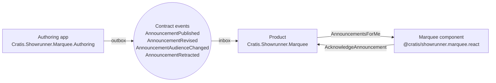

Marquee is built around one idea: an announcement is a fact that belongs to a **product**, not to a tenant, and it travels as a **public event** between two event stores. The people who write it and the people who read it do not share a database, a process or a deployment.

## The path of an announcement

1. **Authoring.** Someone running the product writes an announcement through the [authoring commands](./authoring.md): a title, a Markdown body, an audience, how it is shown, how important it is and when it is active. Each command records a private event in the authoring store.
2. **The contract.** A reactor publishes each private event as one of four [contract events](./contracts.md) to the store's outbox. The contracts name no store; a product subscribes to the authoring store it trusts.
3. **Receiving.** The product records each contract event once for the whole product, not once per tenant, and folds them into the announcements it holds; see [Receiving](./receiving.md). An announcement that was withdrawn is never brought back, whatever order its events arrive in.
4. **Showing.** The product's `AnnouncementsForMe` query returns what the signed-in person is to see in the current tenant. The React component draws it.
5. **Acknowledging.** Closing a dialog that is shown once sends `AcknowledgeAnnouncement`, a fact in the tenant's namespace about that person, so it is gone on every device; see [Acknowledging](./acknowledging.md).

## Audiences

An audience says who an announcement reaches: everybody, named tenants, the holders of a module, or the tenants on a plan. The first two are decided from the audience itself. Whether a tenant holds a module or is on a plan is the business of whatever sells the product, so Marquee asks an `IAudienceEntitlements` that the host plugs in; Box Office provides one, a host can write its own, and without one module and plan audiences reach nobody. See [Contracts](./contracts.md#plugging-in-who-holds-a-module-or-is-on-a-plan).

## Display and importance

Two choices decide how an announcement looks:

| Display | What the person sees | Closed by |
| --- | --- | --- |
| `Banner` | A row at the top of the application for as long as the window lasts | Nobody; it ends when it is withdrawn or its window ends |
| `DialogOnce` | A dialog, until the person acknowledges it | The person, on every device |
| `DialogEverySession` | A dialog, at the start of every session | The person, for this session only |

Importance is `Information`, `Warning` or `Critical`. It sets the icon and the color, and when several dialogs are due the most important opens first. How an announcement is displayed never changes after it is authored: withdraw it and author another.

## Time is applied by the client

The window is an exact UTC start and end. The backend does not filter by it: an announcement scheduled for later is returned with its window, and the React component compares the window with the clock every 60 seconds. A banner therefore appears and disappears on time without a round trip, and without keeping a query open that changes every minute. The start is inclusive and the end is exclusive.

## What the React component does and does not do

`<Marquee />` is a thin layer. The decisions are pure functions that are specified on their own: which announcements are active, in which order dialogs open, which links are safe. The component renders banners and one dialog at a time, closes a dialog through the command, and remembers what was closed in the session. Everything it draws can be replaced; see [Replace the banner or the dialog](./replace-the-banner-or-the-dialog.md).

An announcement is written by an operator, but it is rendered through the same path an account that is not the operator's could reach. So Markdown is rendered as React elements, never as HTML: raw HTML in a body is dropped, images are left out, a link opens in a new tab with `noopener noreferrer`, and only `https`, `mailto` and `tel` links are links at all.

Next: [add announcements to a product](./add-announcements-to-a-product.md).
