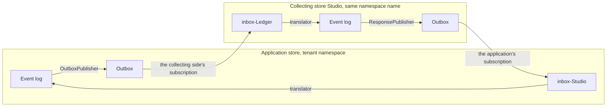

Notes is the product feedback part of Showrunner. A user of an application gives a note about what is on screen, about slices they pick, about the screen itself or about one component, and can suggest a change to a presentation property of that component. The note carries where the user was: the module, feature and slice, the screen, the route, the open dialog and identifiers of model elements. The people building the application receive it as events, and the giver sees what became of it.

In the theatre, the director gives *notes* after a preview performance. Here the application's users are the audience at the preview, and the builder of the application is the director's team: the note's consumer is the application's model, possibly an AI agent that changes it.

Notes is a set of libraries, not a service. Each runs in the Arc and Chronicle process of the system that hosts it:

- [Contracts](./contracts.md): the public events the application and the receiving side exchange, and their value types.
- [Backend](./backend.md): `Cratis.Showrunner.Notes`, which the application hosts: the commands to give, suggest and withdraw a note, the live list of a user's notes with their status, the switch that turns Notes off and the outbox that publishes the notes.
- [Collecting](./collecting.md): `Cratis.Showrunner.Notes.Collecting`, which the builder of the application hosts: it reads the application's outbox, records each note in the namespace its tenant names and answers with acknowledgements and resolutions.
- [Transports](./transports.md): the two ways notes and answers travel between the application and the receiving side: Chronicle's own outbox and inbox in a shared kernel, or HTTP when the application runs its own kernel.
- [Frontend proxies](./frontend-proxies.md): the generated TypeScript proxies.

The React feedback button, picker and dialogs are in `@cratis/showrunner.notes.react`.

## How it differs from Usher

Usher's issues and errors also carry a place in the application, and Notes reuses Usher's `SliceLocation`. But [Usher](../Usher/index.md) is a support conversation with a desk of people: an issue gets work items, a lifecycle and replies. Notes is structured feedback about the model and its surface, and its consumer is the model. Keeping them separate keeps both contracts honest; the two parts are independent and can be used together or alone.

## How it works

The diagram shows the same-kernel transport. An application that runs its own Chronicle kernel uses the [HTTP transport](./transports.md#the-http-transport) instead; everything else is the same.

1. The user gives a note. The command records a private fact in the tenant's namespace, with the signed-in user as giver and as compliance subject.
2. The outbox publisher turns it into a public contract event, named for the tenant.
3. The collecting side, subscribed to the application's outbox, records it as a private fact in the namespace its `TenantId` names.
4. The builder acknowledges, addresses or declines the note. The collecting side publishes `NoteAcknowledged`, `NoteAddressed` or `NoteDeclined`.
5. The application records the answer, and the giver's list of notes shows the new status.
