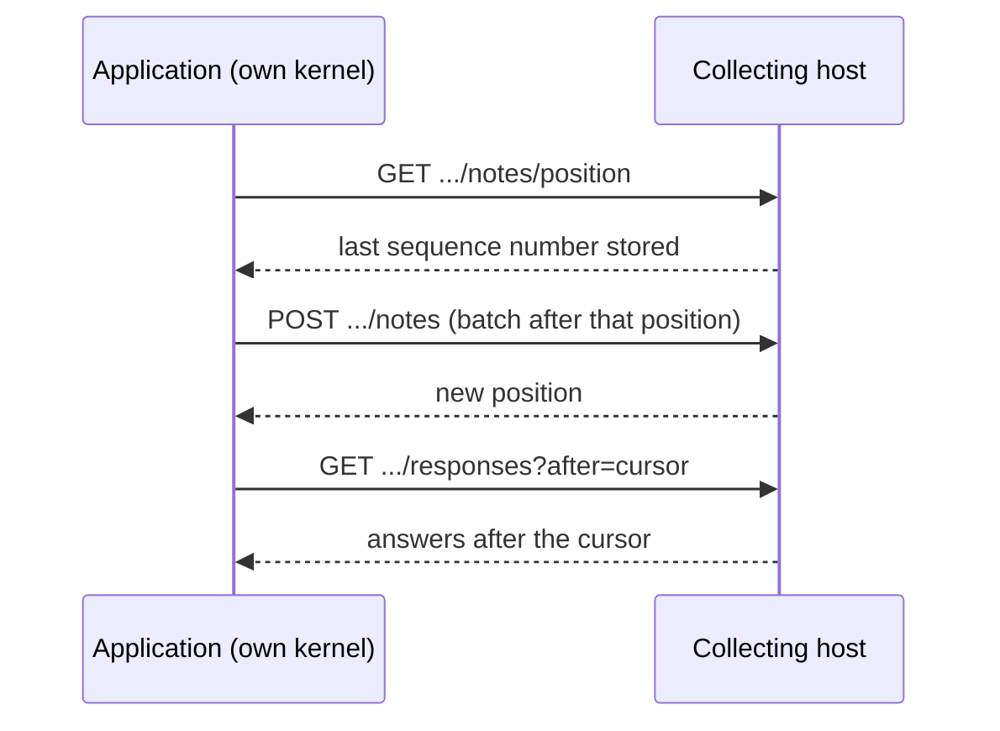

Notes moves two kinds of events: the application's notes to the receiving side, and the receiving side's answers back. The application chooses how with `NotesOptions.Transport`. Everything on each side of the transport is the same either way: the application records the same private facts, the collecting side records the same `…Received` facts, and the giver sees the same status.

| Transport | Use it when | Moves events with |
| --- | --- | --- |
| `SameKernel` (default) | The application's event store and the receiving side's event store live on the same Chronicle kernel. | Chronicle's outbox, subscription and inbox. |
| `Http` | The application runs its own Chronicle kernel, for example in its own pod, and the receiving side has another. | An HTTP relay inside the application and endpoints on the collecting host. |

## The same-kernel transport

Chronicle forwards events between event stores of one kernel through a subscription, so this needs no more than the options described in [Backend](./backend.md) and [Collecting](./collecting.md). It is what Notes did before the HTTP transport existed and it is unchanged.

## The HTTP transport



### Configure the application

```text
Notes__Transport=Http
Notes__CollectorUrl=https://studio.internal:8443
Notes__CollectorTokenFile=/var/run/secrets/notes/token
Notes__CollectorTenantId=acme-corp
```

These are the environment forms of `NotesOptions` bound from a `Notes` configuration section, as shown in [Backend](./backend.md#configuring-notes-from-the-environment). `AddNotes` itself binds nothing; the host does.

| Option | Default | Meaning |
| --- | --- | --- |
| `Transport` | `SameKernel` | `Http` switches the relay on and the same-kernel subscription off. |
| `CollectorUrl` | none, required | Absolute `http` or `https` URL. The endpoints sit under `/.cratis/notes/v1/` on it. |
| `CollectorToken` | none | The bearer secret of the publication. |
| `CollectorTokenFile` | none | A file holding the secret, typically a mounted Kubernetes secret. Read again on every use, so rotating the secret needs no restart. It wins over `CollectorToken`. |
| `CollectorTenantId` | none | The tenant the collector knows the publication by. Every note then names it instead of the application's namespace. |
| `RelayInterval` | five seconds | How often the relay runs a round. After a failed round it waits twice as long for each failure in a row, up to two minutes. |
| `RelayBatchSize` | 100 | The most notes in one request. |

The host fails to start when `Http` is selected without a valid `CollectorUrl`, without a secret, with a `CollectorTokenFile` that does not exist, or with a non-positive `RelayInterval` or `RelayBatchSize`. `PublicationId` identifies the publication in every URL.

`CollectorTenantId` exists because the collector refuses a note that names another tenant than its publication does (see below), and the application does not otherwise know the name the collector gave its tenant. Leave it unset when the application's namespace is named like the tenant.

### What the relay does

A hosted worker, running when `Transport` is `Http`, repeats a round every `RelayInterval`:

1. For each tenant namespace, it asks the collector for the highest outbox sequence number it stored, and reads the application's own outbox after it. The application keeps no checkpoint of its own: at start, and after any failure, the collector's position is the truth.
2. It posts the Notes contract events from that point in batches, in outbox order. Other parts' events in the same outbox are not sent.
3. It reads the answers after its cursor and applies them.

A failed round is logged as a warning without the secret or any note, and retried after a growing delay. The host keeps running.

### Applying the answers

Each answer becomes the private fact the same-kernel transport records (`ReceiverAcknowledgedNote`, `ReceiverAddressedNote` or `ReceiverDeclinedNote`) in the tenant namespace that holds the note, found from the note's own event stream. An answer for a note no namespace holds is logged and skipped.

There is no stored cursor. The application starts from the beginning of the collector's answers and keeps the cursor in memory while it runs. Applying is idempotent because each fact is appended with an idempotency key made of the publication and the answer's cursor, so an answer that was applied appends nothing when it is read again. The key decides, not a comparison with the note's current state: a note that was addressed, then declined, then addressed again must not be turned back by reading the first answer once more after a restart. The cost of the restart is one pass over the answers of the publication.

### The collector endpoints

The host that collects notes maps them with `app.MapNoteCollecting()`. All paths are under `/.cratis/notes/v1/publications/{publicationId}`, and every call carries `Authorization: Bearer <secret>`.

| Call | Query | Body or answer |
| --- | --- | --- |
| `POST notes` | `source` (optional): the namespace of the application the notes come from | Body: a JSON array of `{ sequenceNumber, eventType: { id, generation }, occurred, eventSourceId, content, correlationId?, subject? }`. Answer: `{ sequenceNumber }`, the position now stored. |
| `GET notes/position` | `source` (optional) | `{ sequenceNumber }`, the highest outbox sequence number stored, or `null` when none. |
| `GET responses` | `after`: the cursor of the last answer seen (default zero) | A JSON array of up to 100 `{ cursor, noteId, kind, occurred, version?, reason? }`, in cursor order, for the notes of this publication. `kind` is `Acknowledged`, `Addressed` or `Declined`; `version` is set for `Addressed` and `reason` for `Declined`. |

`content` is the contract event as JSON in camelCase, with concepts as their value and enumerations as their names. `correlationId` and `subject` are optional: the collector records the received fact under them when present, so erasing the giver erases what they wrote on the collecting side too. A cursor is the sequence number of the answer plus one, so it is above zero and `after=0` reads everything.

| Status | Meaning |
| --- | --- |
| 200 | Done. |
| 400 | The body is not a list of notes, or a note could not be read. Nothing was stored. |
| 401 | No bearer secret, a malformed one, a wrong one or an unknown publication. All answer the same, with `WWW-Authenticate: Bearer`. |
| 409 | A note names another tenant than the publication does. Nothing of the batch was stored. |
| 413 | More than 1000 notes in one request. |
| 422 | The publication's tenant has no single namespace in the collecting store. |

On the collecting side a note is recorded by the same code as the same-kernel transport: the received facts are identical, in the namespace the publication names. Each note is recorded once per publication, source and outbox sequence number, however often it is posted. The position is recorded after the batch as an event of its own, `NoteSequenceCollected`, and never moves back, so a batch sent late does not make the application send history again.

### Security model

- **The publication decides the tenant.** The `TenantId` inside a posted note is never used to choose a namespace. It must equal the `TenantId` of the `NotesPublication` the host's `IResolveNotesPublications` returned for the bearer secret. A batch with a mismatch is rejected whole with 409 and logged with the publication and the sequence number, never the content.
- **The secret is the credential of one publication.** The host stores only a hash and compares in constant time inside its resolver. An unknown publication and a wrong secret are indistinguishable to the caller.
- **The secret is never logged.** Not by the relay, not by the collector, and not in the exception for a refused request, which carries only the status code. Prefer `CollectorTokenFile` to `CollectorToken`, so the secret is not in configuration, in an environment dump or in a process listing.
- **Use TLS.** The secret travels as a bearer token. Use an `https` `CollectorUrl` unless the route between the two never leaves a network you trust.
- **The endpoints use no user authentication, so expose them only on an internal address.** They allow anonymous callers on purpose, because the callers are applications and not users. Map them on a listener or service that published applications reach and the public does not, never on the host's public ingress.
