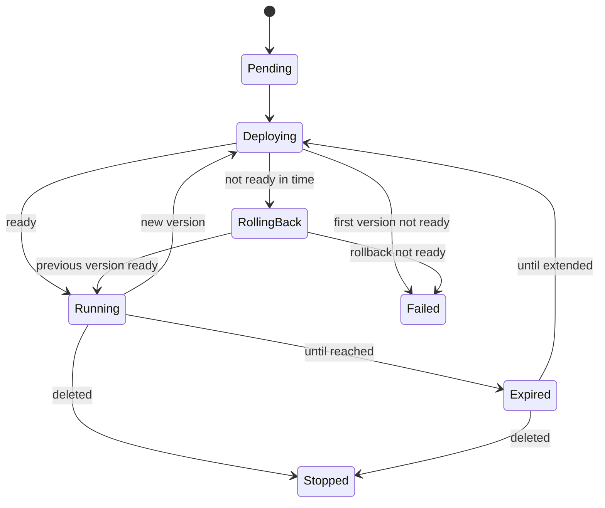

`StageApplication` (`showrunner.cratis.io/v1alpha1`, short name `stageapp`) is namespaced. The publisher chooses the namespace. The resource name is the published name, a DNS label that is unique within the namespace. The definition is in `Deployment/Helm/stage-operator/crds/stageapplications.showrunner.cratis.io.yaml`.

The publisher labels the resource with `showrunner.cratis.io/publication-id` and `showrunner.cratis.io/organization`.

```yaml
apiVersion: showrunner.cratis.io/v1alpha1
kind: StageApplication
metadata:
  name: orders
  namespace: published
spec:
  publicationId: 6f9619ff-8b86-d011-b42d-00cf4fc964ff
  organization: example-organization
  publishedName: orders
  version: 1.4.0
  image: registry.example.invalid/orders@sha256:0123456789abcdef
  package:
    configMapRef: orders-package-1-4-0
  lifetime:
    permanent: true
  authentication:
    proxyImage: registry.example.invalid/proxy:1
    configSecretRef: orders-auth
    port: 8080
  notes:
    enabled: true
    configSecretRef: orders-notes
    collectorUrl: https://collector.example.invalid:8443
    collectorTokenSecretRef: orders-notes-token
  resources:
    requests: { cpu: 250m, memory: 512Mi }
    limits: { cpu: "1", memory: 1Gi }
  storage:
    size: 5Gi
```

## spec

| Field | Meaning |
| --- | --- |
| `publicationId`, `organization` | The publication and organization in the publisher's system. |
| `publishedName` | The DNS label of the application. Must equal `metadata.name` and cannot change. The host is `<publishedName>.<BaseDomain>`. |
| `version` | The application version. |
| `image` | The Stage image to run. Either an exported application image (`FROM` the Stage image) with the package baked in at `/stage/package`, or, when `package.configMapRef` is set, the generic Stage runtime image. Use a digest where possible. |
| `package.configMapRef` | Optional. The name of a ConfigMap in the same namespace whose `binaryData` key `package.tar.gz` holds the package archive. The operator mounts only that key, read-only, at `/stage/package-archive/` in the Stage container and sets `Stage__Published__PackagePath=/stage/package-archive/package.tar.gz`; Stage extracts the archive at startup. The operator never reads the ConfigMap and needs no rights on ConfigMaps. A change of `package.configMapRef` alone is a new rollout. |
| `lifetime` | Exactly one of `permanent: true` or `until` (an RFC 3339 timestamp). |
| `authentication` | **Required.** `proxyImage` is the sign-in proxy that runs in the same pod; `configSecretRef` names the secret whose keys become the proxy's environment (providers, client secrets, cookie domain); `port` is the port the proxy listens on (default 8080). It cannot be 9090, 35000 or 27017. |
| `notes.enabled` | Enable the Notes backend in Stage. `notes.configSecretRef` is an optional secret with extra environment for it. |
| `notes.collectorUrl`, `notes.collectorTokenSecretRef` | Optional, set together, used when `notes.enabled`. Sends the application's notes to the collector over the [HTTP transport](../Notes/transports.md). The secret (key `token`) is mounted read-only at `/stage/notes/token`, and Stage gets `Notes__Transport=Http`, `Notes__CollectorUrl`, `Notes__CollectorTokenFile=/stage/notes/token`, `Notes__PublicationId` (from `publicationId`), `Notes__CollectorTenantId` (from `organization`) and `Notes__ApplicationName` (from `publishedName`). The operator only references the secret by name. The application pod's NetworkPolicy restricts ingress only, so egress to the collector is not blocked by the operator; a cluster-wide default-deny egress policy must allow it. |
| `resources` | Requests and limits of the Stage container. Defaults: requests 250m cpu and 512Mi memory, limits 1 cpu and 1Gi memory. |
| `storage.size` | Size of the MongoDB volume (default 5Gi). It is fixed when the volume is created. |

Secrets are never copied or read by the operator: they are referenced by name, and the kubelet injects them into the pod. The publisher creates them in the same namespace.

## status

Only the operator writes the status.

| Field | Meaning |
| --- | --- |
| `phase` | `Pending`, `Deploying`, `Running`, `RollingBack`, `Failed`, `Expired` or `Stopped` (the resource is being deleted). |
| `runningVersion`, `runningImage`, `runningPackage` | What is running now, including the package ConfigMap when there is one. After a rollback, the previous version. |
| `url` | `https://<publishedName>.<BaseDomain>`. |
| `expiresAt` | The expiry, or empty when permanent. |
| `dataRetainedUntil` | While expired or being deleted, when the data is removed. |
| `observedGeneration` | The generation of the spec the status describes. |
| `conditions` | `Ready`, `Progressing`, `Degraded` and `Expired`, each with `status`, `reason`, `message` and `lastTransitionTime`. |
| `versions` | The rollout history, newest last, at most 20: `version`, `image`, `package`, `rolledOutAt`, `outcome` (`RolledOut`, `RolledBack` or `Failed`) and `reason`. |
| `rollout` | The rollout in progress, with its start time; empty otherwise. |
| `resourceUsage` | Accumulated usage of all containers of the application's pods (Stage, proxy, MongoDB): `measured`, `cpuCoreSeconds`, `peakMemoryBytes`, `averageMemoryBytes`, `windowStart`, `windowEnd`, `sampleCount`. |
| `lastPeriodUsage` | The same for the last completed UTC day, with `day`, for periodic reporting. |
| `currentDayUsage` | The UTC day in progress; it becomes `lastPeriodUsage` when the day ends. |

CPU is integrated from the sampled use over the time between samples; a gap longer than five minutes (the sampler was down) is not counted.

## Lifecycle



## RBAC for the publisher

The chart creates a `ClusterRole` named `stage-application-publisher` (`publisher.createRole`). Bind it with a `RoleBinding` in each namespace the publisher publishes to. It allows `get`, `list`, `watch`, `create`, `update`, `patch` and `delete` on `stageapplications`, `get` on `stageapplications/status`, and manage on the `secrets` the resources reference.
