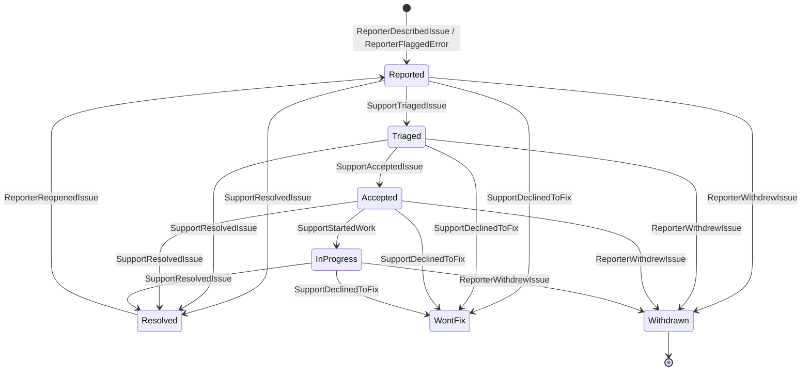

`Cratis.Showrunner.Usher` gives an application's users the backend for reporting issues and talking to support: commands to report, answer and manage their issues, and live queries for the list of their issues and the conversation on one. Everything is recorded as private events in the application's own event store, in the tenant's namespace.

## Add Usher to an application

Reference the `Cratis.Showrunner.Usher` package and call `AddUsher` on the host builder, next to `AddCratis`:

```csharp
var builder = WebApplication.CreateBuilder(args);
builder.AddCratis();
builder.AddUsher(usher =>
{
    usher.ApplicationName = "Ledger";
    usher.DeskStores = ["Direct"];
});
```

| Option | Default | Meaning |
| --- | --- | --- |
| `ApplicationName` | none, required | The name the support desk sees on every report. A desk serves several applications and tells them apart by it. |
| `DeskStores` | `["Direct"]` | The event stores of the support desks the application talks to. |

The host fails to start when `ApplicationName` is not set. Arc discovers Usher's commands and queries, and Chronicle its events and read models, from the referenced assembly; there is nothing else to register.

Every command and query requires a signed-in user. Usher takes who the reporter is from the signed-in identity, never from the request: the `sub` claim (or the name identifier) is the reporter's subject, the `name` and `email` claims are what support sees when the reporter shares who they are, and the identity provider comes from Arc's identity provider claim.

## Commands

| Slice | Command | What it records |
| --- | --- | --- |
| `Reporting/ReportIssue` | `ReportIssue(IssueId, Location, CorrelationIds, Summary, Description, ApplicationVersion, ShareIdentity, GrantAccess, AccessDuration)` | `ReporterDescribedIssue`, then `ReporterSharedIdentity` and `ReporterGrantedAccess` when chosen |
| `Reporting/ReportError` | `ReportError(IssueId, Location, CorrelationIds, StackFrames, ErrorMessage, ErrorType, Details, ApplicationVersion, ShareIdentity, GrantAccess, AccessDuration)` | `ReporterFlaggedError`, then `ReporterAddedDetails`, `ReporterSharedIdentity` and `ReporterGrantedAccess` when present |
| `Identity/ShareIdentity` | `ShareIdentity(IssueId)` | `ReporterSharedIdentity` |
| `Conversation/AddDetails` | `AddDetails(IssueId, Details)` | `ReporterAddedDetails` |
| `Conversation/AnswerQuestion` | `AnswerQuestion(IssueId, QuestionId, Answer)` | `ReporterAnsweredQuestion` |
| `Lifecycle/ReopenIssue` | `ReopenIssue(IssueId, Reason)` | `ReporterReopenedIssue` |
| `Lifecycle/WithdrawIssue` | `WithdrawIssue(IssueId)` | `ReporterWithdrewIssue` |
| `Access/GrantAccess` | `GrantAccess(IssueId, AccessDuration)` | `ReporterSharedIdentity` when not shared yet, then `ReporterGrantedAccess` |
| `Access/RevokeAccess` | `RevokeAccess(IssueId)` | `ReporterRevokedAccess` |

The caller chooses the `IssueId` of a new issue, so a retried report does not open a second issue. `AccessDuration` is `OneHour`, `OneDay` or `SevenDays`; the command turns it into a fixed end time, so the recorded grant always means the same thing. Granting access always shares who the reporter is first, because support can only act as someone it knows.

The commands refuse, with a validation error:

- a report that reuses the id of an existing issue, a summary that is empty or longer than 120 characters, an empty description, and an error without a message;
- any command on an issue the signed-in user did not report. Someone else's issue is answered exactly like an issue that does not exist, so an issue id reveals nothing;
- anything after the reporter withdrew the issue, except revoking access, which only narrows what support can do;
- sharing identity twice, empty details and empty answers;
- answering a question that was never asked or is already answered;
- reopening an issue that is not resolved, or without a reason;
- withdrawing an issue that is already closed (resolved or won't fix);
- granting access while a grant is live, and revoking when none is.

A grant is live from when it is given until it is revoked, it lapses, or its end time passes.

## Queries

Both queries are observable: the client gets the current result and a new one every time it changes.

| Slice | Query | Returns |
| --- | --- | --- |
| `Listing` | `ReportedIssue.MyIssues()` | The signed-in reporter's issues, most recent activity first |
| `Viewing` | `IssueConversation.ForIssue(issueId)` | One of the signed-in reporter's issues with everything that happened on it; nothing for an issue they did not report |

**`ReportedIssue`** has `Id`, `Kind` (`Error`, `Manual`), `Title` (the summary, or the error message), `State`, `ReportedAt`, `LastActivityAt`, `WaitingOnReporter` (support asked something not yet answered), `KnownIssueTitle`, `WorkItem`, `FixedInVersion`, `ReporterSubject` and `OpenQuestions`.

**`IssueConversation`** has `Id`, `Title`, `State`, `Location`, `ReportedAt`, `IdentityShared`, `OpenQuestion` (the latest unanswered question), `Entries`, `Access`, `KnownIssueTitle`, `WorkItem`, `FixedInVersion` and `ReporterSubject`.

- Each entry has `EntryId`, `Kind`, `Text`, `AuthorKind` (`Reporter`, `Support`, `Agent`, `System`), `AuthorName`, `At` and `QuestionId`. Questions and replies are from support or an agent, with the name the desk lets the reporter see; state changes, links, access requests, lapses and releases are from `System`.
- `Access` has `State` (`NotGranted`, `Granted`, `Revoked`, `Lapsed`), `ValidUntil`, the pending `Request` with its reason, and the `Sessions` in which support signed in as the reporter.

A value that is not there is empty or `NotSet`, never null.

Usher stores issues in the tenant's own event store namespace, so both queries only see the current tenant's issues; within it they return only issues whose `ReporterSubject` is the signed-in user's subject.

## The lifecycle of an issue



The desk drives the issue forward; the state follows whatever the desk last did. A reopened issue goes back to `Reported`, because it is new work the desk triages again, and the release that shipped the fix is cleared from it. `Withdrawn` is final: a desk event that crossed the withdrawal is recorded in the conversation but does not change the state.

## Private events

The events are private to the application, keyed by the issue id. The [contracts](./contracts.md#mapping-to-private-events) page maps each to the public event exchanged with the desk.

The reporter's side, recorded by the commands:

| Event | Payload |
| --- | --- |
| `ReporterDescribedIssue` | `Location`, `CorrelationIds`, `Summary`, `Description`, `ApplicationName`, `ApplicationVersion`, `ReporterSubject` |
| `ReporterFlaggedError` | `Location`, `CorrelationIds`, `StackFrames`, `ErrorMessage`, `ErrorType`, `Fingerprint`, `ApplicationName`, `ApplicationVersion`, `ReporterSubject` |
| `ReporterSharedIdentity` | `Reporter` |
| `ReporterAddedDetails` | `Details` |
| `ReporterAnsweredQuestion` | `QuestionId`, `Answer` |
| `ReporterReopenedIssue` | `Reason` |
| `ReporterWithdrewIssue` | none |
| `ReporterGrantedAccess` | `ValidUntil` |
| `ReporterRevokedAccess` | none |

The desk's side, in the `Receiving` folder, recorded when the application receives the desk's public events: `SupportTriagedIssue`, `SupportAcceptedIssue`, `SupportDeclinedToFix(Reason)`, `SupportAskedQuestion(QuestionId, Question, Author)`, `SupportReplied(Reply, Author)`, `SupportLinkedIssueToKnownIssue(KnownIssueId, Title)`, `SupportUnlinkedIssue(KnownIssueId)`, `SupportLinkedIssueToWorkItem(WorkItem)`, `SupportUnlinkedWorkItem(WorkItemReference)`, `SupportStartedWork`, `SupportResolvedIssue(Resolution)`, `SupportRequestedAccess(Reason)` and `ReleaseShippedFix(ReleaseVersion, WorkItemReference)`.

Access, recorded by the application itself:

| Event | Payload |
| --- | --- |
| `AccessGrantLapsed` | `ValidUntil` of the grant that ended, so a late lapse of an earlier grant never ends a later one |
| `SupportSignedInAsReporter` | `SessionId`, `Author` |
| `SupportSessionEnded` | `SessionId` |

### Personal data

`ReporterSharedIdentity` is the only event with personal data: the reporter's name and email are classified `[PII]` and encrypted with the issue as compliance subject. `ReporterSubject`, the identity provider's id for the reporter, is recorded on the first event of every issue so the reporter finds their own issues even when they never share who they are. It is a pseudonymous key, not classified, and never published to the desk; the desk learns the reporter only through `ReporterSharedIdentity`.

### Error fingerprints

`ReporterFlaggedError` carries a `Fingerprint` that lets the desk group reports of the same error. Until fingerprinting is built, every error is recorded with an unset fingerprint, which the desk treats as not grouped. An application can register its own `IComputeErrorFingerprints` before calling `AddUsher`.
