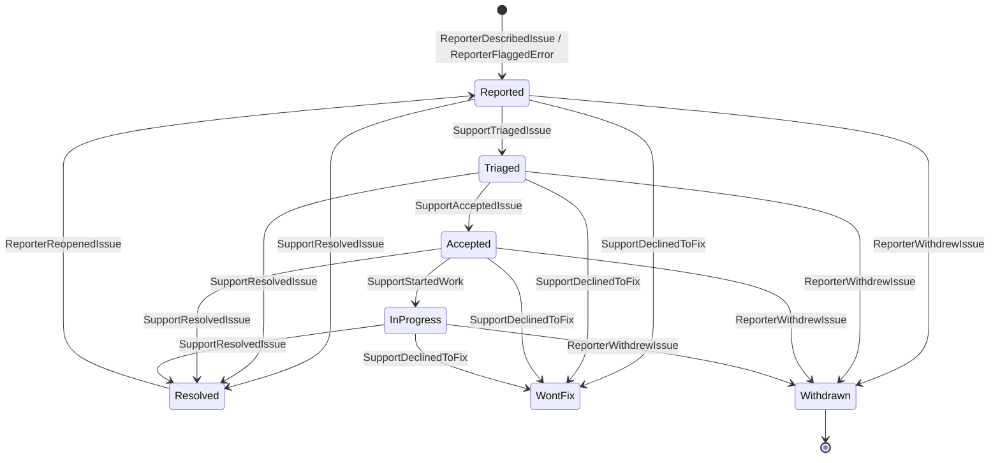

`Cratis.Showrunner.Usher` gives an application's users the backend for reporting issues and talking to support: commands to report, answer and manage their issues, and live queries for the list of their issues and the conversation on one. Everything is recorded as private events in the application's own event store, in the tenant's namespace.

## Add Usher to an application

Reference the `Cratis.Showrunner.Usher` package and call `AddUsher` on the host builder, next to `AddCratis`:

```csharp
var builder = WebApplication.CreateBuilder(args);
builder.AddCratis();
builder.AddUsher(usher =>
{
    usher.ApplicationName = "Ledger";
    usher.DeskStores = ["Direct"];
});
```

| Option | Default | Meaning |
| --- | --- | --- |
| `ApplicationName` | none, required | The name the support desk sees on every report. A desk serves several applications and tells them apart by it. |
| `DeskStores` | `["Direct"]` | The event stores of the support desks the application talks to. |
| `PollingInterval` | one minute | How often Usher looks for new tenant namespaces and for grants of access whose end has passed. A grant lapses at most this long after its end. |
| `OnBehalf` | unset | How Usher answers AuthProxy's on-behalf sessions, in which support signs in as a reporter. Unset, support cannot. See [Access and support sessions](./access-and-sessions.md#configure-authproxy-and-usher-together). |

The host fails to start when `ApplicationName` is not set. Arc discovers Usher's commands and queries, and Chronicle its events, read models and reactors, from the referenced assembly; there is nothing else to register. `AddUsher` also adds a hosted service that exchanges events with the desks and lapses grants; see [Exchanging events with a desk](./desk-exchange.md).

Every command and query requires a signed-in user. Usher takes who the reporter is from the signed-in identity, never from the request: the `sub` claim (or the name identifier) is the reporter's subject, the `name` and `email` claims are what support sees when the reporter shares who they are, and the identity provider comes from Arc's identity provider claim. A subject is unique only within its identity provider, so Usher identifies the reporter by the pair, `UserIdentity(IdentityProvider, Subject)`: two people with the same subject at two providers never see or act on each other's issues, and a captured error is kept for the pair too.

## Commands

| Slice | Command | What it records |
| --- | --- | --- |
| `Reporting/ReportIssue` | `ReportIssue(IssueId, Location, CorrelationIds, Summary, Description, ApplicationVersion, ShareIdentity, GrantAccess, AccessDuration)` | `ReporterDescribedIssue`, then `ReporterSharedIdentity` and `ReporterGrantedAccess` when chosen |
| `Reporting/ReportError` | `ReportError(IssueId, Location, CorrelationIds, StackFrames, ErrorMessage, ErrorType, Details, ApplicationVersion, ShareIdentity, GrantAccess, AccessDuration)` | `ReporterFlaggedError`, then `ReporterAddedDetails`, `ReporterSharedIdentity` and `ReporterGrantedAccess` when present |
| `Identity/ShareIdentity` | `ShareIdentity(IssueId)` | `ReporterSharedIdentity` |
| `Conversation/AddDetails` | `AddDetails(IssueId, Details)` | `ReporterAddedDetails` |
| `Conversation/AnswerQuestion` | `AnswerQuestion(IssueId, QuestionId, Answer)` | `ReporterAnsweredQuestion` |
| `Lifecycle/ReopenIssue` | `ReopenIssue(IssueId, Reason)` | `ReporterReopenedIssue` |
| `Lifecycle/WithdrawIssue` | `WithdrawIssue(IssueId)` | `ReporterWithdrewIssue` |
| `Access/GrantAccess` | `GrantAccess(IssueId, AccessDuration)` | `ReporterSharedIdentity` when not shared yet, then `ReporterGrantedAccess` |
| `Access/RevokeAccess` | `RevokeAccess(IssueId)` | `ReporterRevokedAccess` |

The caller chooses the `IssueId` of a new issue, so a retried report does not open a second issue. `AccessDuration` is `OneHour`, `OneDay` or `SevenDays`; the command turns it into a fixed end time, so the recorded grant always means the same thing. Granting access always shares who the reporter is first, because support can only act as someone it knows.

The commands refuse, with a validation error:

- a report that reuses the id of an existing issue, a summary that is empty or longer than 120 characters, an empty description, and an error without a message;
- any command on an issue the signed-in user did not report. Someone else's issue is answered exactly like an issue that does not exist, so an issue id reveals nothing;
- anything after the reporter withdrew the issue. Withdrawing ends support's access, so there is nothing left to revoke;
- sharing identity twice, empty details and empty answers;
- answering a question that was never asked or is already answered;
- reopening an issue that is not resolved, or without a reason;
- withdrawing an issue that is already closed (resolved or won't fix);
- granting access while a grant is live, and revoking when none is.

A grant is live from when it is given until it is revoked, it lapses, its end time passes, or the reporter withdraws the issue. How support uses a grant to sign in as the reporter through AuthProxy, and the endpoints Usher maps for it, are in [Access and support sessions](./access-and-sessions.md).

## Queries

Both queries are observable: the client gets the current result and a new one every time it changes.

| Slice | Query | Returns |
| --- | --- | --- |
| `Listing` | `ReportedIssue.MyIssues()` | The signed-in reporter's issues, most recent activity first |
| `Viewing` | `IssueConversation.ForIssue(issueId)` | One of the signed-in reporter's issues with everything that happened on it, as a collection holding the issue or nothing: empty for an issue they did not report |

**`ReportedIssue`** has `Id`, `Kind` (`Error`, `Manual`), `Title` (the summary, or the error message), `State`, `ReportedAt`, `LastActivityAt`, `WaitingOnReporter` (support asked something not yet answered), `KnownIssueTitle`, `WorkItem`, `FixedInVersion`, `ReportedBy` and `OpenQuestions`.

**`IssueConversation`** has `Id`, `Title`, `State`, `Location`, `ReportedAt`, `IdentityShared`, `OpenQuestion` (the latest unanswered question), `Entries`, `Access`, `KnownIssueTitle`, `WorkItem`, `FixedInVersion` and `ReportedBy`.

- Each entry has `EntryId`, `Kind`, `Text`, `AuthorKind` (`Reporter`, `Support`, `Agent`, `System`), `AuthorName`, `At`, `QuestionId`, and `ActedBy` and `Session` for what support did while signed in as the reporter (see [What the reporter sees](./access-and-sessions.md#what-the-reporter-sees)). Questions and replies are from support or an agent, with the name the desk lets the reporter see; state changes, links, access requests, lapses and releases are from `System`.
- `Access` has `State` (`NotGranted`, `Granted`, `Revoked`, `Lapsed`), `ValidUntil`, the pending `Request` with its reason, and the `Sessions` in which support signed in as the reporter.

A value that is not there is empty or `NotSet`, never null.

Usher stores issues in the tenant's own event store namespace, so both queries only see the current tenant's issues; within it they return only issues whose `ReportedBy` is the signed-in user's identity provider and subject.

## The lifecycle of an issue



The desk drives the issue forward; the state follows whatever the desk last did. A reopened issue goes back to `Reported`, because it is new work the desk triages again, and the release that shipped the fix is cleared from it. `Withdrawn` is final: a desk event that crossed the withdrawal is recorded in the conversation but does not change the state.

## Private events

The events are private to the application, keyed by the issue id. The [contracts](./contracts.md#mapping-to-private-events) page maps each to the public event exchanged with the desk.

The reporter's side, recorded by the commands:

| Event | Payload |
| --- | --- |
| `ReporterDescribedIssue` | `Location`, `CorrelationIds`, `Summary`, `Description`, `ApplicationName`, `ApplicationVersion`, `ReportedBy` |
| `ReporterFlaggedError` | `Location`, `CorrelationIds`, `StackFrames`, `ErrorMessage`, `ErrorType`, `Fingerprint`, `ApplicationName`, `ApplicationVersion`, `ReportedBy` |
| `ReporterSharedIdentity` | `Reporter` |
| `ReporterAddedDetails` | `Details` |
| `ReporterAnsweredQuestion` | `QuestionId`, `Answer` |
| `ReporterReopenedIssue` | `Reason` |
| `ReporterWithdrewIssue` | none |
| `ReporterGrantedAccess` | `ValidUntil` |
| `ReporterRevokedAccess` | none |

The desk's side, in the `Receiving` folder, recorded when the application receives the desk's public events: `SupportTriagedIssue`, `SupportAcceptedIssue`, `SupportDeclinedToFix(Reason)`, `SupportAskedQuestion(QuestionId, Question, Author)`, `SupportReplied(Reply, Author)`, `SupportLinkedIssueToKnownIssue(KnownIssueId, Title)`, `SupportUnlinkedIssue(KnownIssueId)`, `SupportLinkedIssueToWorkItem(WorkItem)`, `SupportUnlinkedWorkItem(WorkItemReference)`, `SupportStartedWork`, `SupportResolvedIssue(Resolution)`, `SupportRequestedAccess(Reason)` and `ReleaseShippedFix(ReleaseVersion, WorkItemReference)`.

Access, recorded by the application itself:

| Event | Payload |
| --- | --- |
| `AccessGrantLapsed` | `ValidUntil` of the grant that ended, so a late lapse of an earlier grant never ends a later one. Appended by Usher's background work when the end passes; see [Lapsing grants of access](./desk-exchange.md#lapsing-grants-of-access). |
| `SupportSignedInAsReporter` | `SessionId` (AuthProxy's opaque session identifier), `Author` |
| `SupportSessionEnded` | `SessionId`; recorded once per session, see [Recording sessions](./access-and-sessions.md#recording-sessions) |

### Personal data

Everything the reporter writes (`Summary`, `Description`, `Details`, `Answer`, `ReopenReason`, `ErrorMessage`) and who they are (`ReporterName`, `Email`, `IdentityProviderSubject`) is classified `[PII]`. The reporter's commands append every fact with the reporter, not the issue, as compliance subject: `ReporterSubjects.For(identity)`, a one-way hash of the identity provider and subject. Erasing that subject in a tenant's namespace erases what the person wrote on all their issues there. `ReportedBy`, the identity provider and subject of the reporter, is recorded on the first event of every issue so the reporter finds their own issues even when they never share who they are; it is never published to the desk, which learns the reporter only through `ReporterSharedIdentity`. How the classification reaches the desk is in [Contracts](./contracts.md#personal-data).

### Error fingerprints

`ReporterFlaggedError` carries a `Fingerprint` that lets the desk group reports of the same error. It is a SHA-256 hash, written as 64 lowercase hexadecimal characters, of:

- the application version;
- the slice location: module, feature and slice;
- the error type;
- the error message, normalized: GUIDs and hexadecimal ids (`0x` numbers, and runs of eight or more hexadecimal characters with a digit in them) become `<id>`, the remaining numbers become `<n>`, and whitespace collapses to single spaces. Quoted values are kept, because they usually name the field or entity the error is about;
- the top stack frame, when there is one: its method, the file name without its folder or URL, and its line. Without stack frames, the fingerprint is built from the rest.

So `Invoice 3f2504e0-… was not found after 3 attempts` and `Invoice 9b1deb4d-… was not found after 5 attempts` in the same slice and version give the same fingerprint, and the same error in the next version gives another one. The exact input is documented on `ErrorFingerprints`; the algorithm is versioned and never changes in place, because fingerprints are stored forever. An application can register its own `IComputeErrorFingerprints` before calling `AddUsher`.

## Error capture

When a command fails with an exception, Usher captures the error as the backend saw it: the command's slice location, the error type and message, the stack frames from the .NET runtime and the application version. It keeps the error for a short while under the command's correlation id, for the signed-in user in the current tenant. When that user then reports the error with `ReportError` and the failing command's correlation id is among the `CorrelationIds`, the error is recorded as the backend captured it, and its fingerprint is computed from that, instead of from what the client sends. The correlation ids themselves are recorded as sent.

- Only the same user in the same tenant can use a captured error; for anyone else, and when nothing was captured, the report is recorded from what the client sends, as it is without capture. Errors of anonymous requests are not captured.
- Capturing never changes how a command fails: Usher observes the exception and leaves the result to Arc. If capturing itself fails, it is logged and the command fails with its own exception. A command whose exception another `ICommandExceptionMapper` maps is not captured.
- Captured errors live in memory in the process that ran the command. A report handled by another instance finds nothing and is recorded from what the client sends.
- Nothing more reaches the client than Arc already returns for a failing command: the stack frames stay on the server until the user reports the error.
- Failing queries are not captured: Arc gives an application no hook into the exception of a query. A query error is reported from what the client sends.

| Option | Default | Meaning |
| --- | --- | --- |
| `ApplicationVersion` | the informational version of the entry assembly, without build metadata | The version recorded with captured errors. |
| `ErrorCapture.Enabled` | `true` | Whether failing commands are captured. |
| `ErrorCapture.Retention` | 15 minutes | How long a captured error is kept for a report to use. |
| `ErrorCapture.Capacity` | 1000 | How many captured errors are kept at most, across all tenants and users; the oldest go first. |
| `ErrorCapture.MaximumStackFrames` | 50 | How many stack frames, from the top, are kept. |
