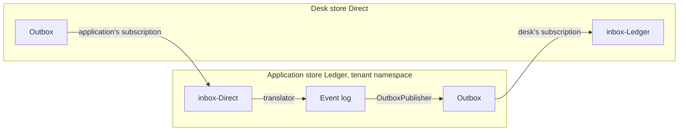

`AddUsher` connects the application to the support desks named in `DeskStores` with no further code. The application publishes what the reporter does to its outbox, and records what the desk does as private `Support…` facts in the tenant's namespace. This page explains how that works, what a desk has to do on its side, and what to expect in operation. The events themselves and the mapping between public and private events are in [Contracts](./contracts.md).

## Background work

Usher adds a hosted service that runs a round of work when the host starts and then every `PollingInterval` (one minute by default). Each round:

1. Opens the application's event store in the default namespace and in every tenant namespace it has. Chronicle runs the application's observers only in namespaces the application has opened, and Usher has work to do in a tenant even when none of its users is signed in.
2. Observes the inbox of each desk store in every one of those namespaces.
3. Subscribes the application's event store to the outbox of each desk store.
4. Lapses the grants of access whose end has passed.

Everything a round acts on is stored in Chronicle, so a restart loses nothing: the first round after it catches up. A round that fails is logged as a warning and the next round tries again. A new tenant namespace is served from the first round after it appears.

## Publishing to the desk

The `Publishing/OutboxPublisher` reactor turns each private fact the reporter records, and each lapsed grant, into its public event, and appends it to the outbox of the same namespace under the same issue id. The public event:

- names the namespace as its `TenantId`;
- keeps the private fact's correlation id, compliance subject and the time it happened;
- never carries `ReporterSubject`. The desk learns who reported only from `IssueAttributedToReporter`, which is published when the reporter shares who they are.

Public events go only to the outbox, never to the event log.

Chronicle delivers an event to a reactor at least once: a failed partition is delivered again when it recovers. Each publication is appended with an idempotency key derived from the delivery, so a repeated delivery finds its publication already in the outbox and appends nothing. The reactor is also excluded from replay, so replaying it does not try to publish history again. A newly deployed publisher does catch up: it publishes everything the namespace recorded before it ran.

## Receiving from the desk

For each desk store, Usher subscribes the application's store to the desk's outbox, with the desk store's name as the subscription id, filtered to the thirteen desk-to-application events. Subscribing again with the same id keeps the existing subscription, so this is safe on every start. Chronicle forwards each desk event into the `inbox-{desk store}` sequence of the application's store, in the namespace the desk published it in.

A translator per desk store observes that inbox in every namespace and records each event as its private fact:

- It appends the private fact to the event log of the namespace that the event's `TenantId` names, under the same issue id. A desk that serves many tenants can therefore publish from one namespace.
- The private fact keeps the time the desk recorded the event as its `Occurred`, and the event's correlation id.
- An event that names no tenant, a tenant namespace the application does not have, or an issue that was never reported in that tenant, is logged as a warning and skipped. It changes nothing, and failing on it would hold up the desk's later events.
- The forwarder can put the same desk event into the inbox twice. The private fact is appended with an idempotency key derived from the desk event itself (the desk store, the issue, the event type, when the desk recorded it, its correlation id and its content), so every copy records one fact. Two events the desk recorded separately are both recorded, even when their content is the same.

The translator is not replayable: replaying an inbox would only translate events that are already recorded.

## Lapsing grants of access

A grant of access has a fixed end. When the end passes without the reporter revoking it, Usher appends `AccessGrantLapsed`, which is published as `AccessExpired`.

The `GrantToLapse` read model holds the grant in effect on each issue. Each round reads it in every namespace and, for each grant whose end has passed, decides against the issue's own events: it appends the lapse only when the last access event on the issue is a grant whose end has passed. The append is guarded by a concurrency scope on those events, so a grant revoked or replaced in the meantime is never lapsed, and keyed by the issue and the grant's end, so two instances lapsing the same grant append it once.

A grant lapses at most one `PollingInterval` after its end, and later when the application was not running at that moment. Support cannot sign in on a grant past its end in the meantime: whether a grant is live is always checked against the clock.

## Setting up a desk

A desk, such as Direct, references `Cratis.Showrunner.Usher.Contracts` and does three things for each application store it serves:

1. Subscribe its own store to the application's outbox for the application-to-desk events; see [Subscribe to the other side](./contracts.md#subscribe-to-the-other-side).
2. Open its store in each tenant namespace of the application. The application publishes in the tenant's namespace, and Chronicle forwards it into the inbox of the same namespace on the desk's store, which only happens in namespaces the desk's store has.
3. Observe `inbox-{application store}` in those namespaces, and treat an event that arrives twice as one.

The desk answers under the same issue id and names the tenant in `TenantId`. It can publish from any namespace the application's store has, its default namespace included.
